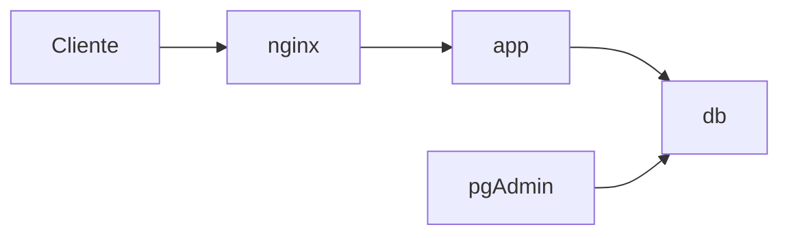

# AE4 — Aplicación Web con base de datos en contenedores

Desplegar una aplicación Web contenerizada con capa de datos:

- Servidor de aplicaciones Django + Gunicorn.
- Base de datos PostgreSQL.
- Administrada con pgAdmin.
- Servidor Web nginx como proxy inverso.

Todo definido con Docker Compose, verificado con los comandos estándar y desplegable con un `deploy.sh`.

## Preparación del proyecto

Creé la carpeta de trabajo e inicié el repositorio Git:

```bash
mkdir -p ~/dpl/ae4
cd ~/dpl/ae4
git init
```

Después copié el material de la unidad y adapté los archivos a la estructura de la actividad.

## Docker Compose

Preparé `compose.yml` con los cuatro servicios:

```text
db
pgadmin
app
nginx
```

Comprobé que la configuración estaba bien con:

```bash
sudo docker compose config -q
echo $?
```

El resultado fue:

```text
0
```

La aplicación se puede consultar en:

```text
http://localhost:8000
```

y pgAdmin en:

```text
http://localhost:5050
```

## nginx

Configuré nginx como proxy inverso para recibir las peticiones de los clientes y reenviarlas al servicio `app` en el puerto 8000.

```nginx
location / {
    proxy_pass http://app:8000;
}
```

## Arquitectura



## Comprobación del despliegue

Arranqué los servicios con:

```bash
sudo docker compose up -d
sudo docker compose ps
```

Los cuatro servicios funcionan correctamente.

También comprobé que la aplicación respondía:

```bash
curl http://localhost:8000/
```

y que el estado de la aplicación era correcto:

```bash
curl -sf http://localhost:8000/healthz
```

Resultado:

```text
{"status": "ok", "hostname": "390f795a2e11"}
```

## Base de datos

Comprobé que PostgreSQL contiene los 11 sitios:

```bash
sudo docker compose exec -T db psql -U alumno -d travelroad -c "SELECT count(*) FROM places;"
```

Resultado:

```text
11
```

También comprobé que la aplicación devuelve esos datos:

```bash
curl -sf http://localhost:8000/api/lugares
```

La respuesta devuelve los 11 sitios.

## pgAdmin

Accedí a pgAdmin desde:

```text
http://localhost:5050
```

Registré el servidor con:

```text
Host: db
Puerto: 5432
Base de datos: travelroad
Usuario: alumno
```

Desde pgAdmin comprobé que la tabla `places` contiene los 11 registros.

## Persistencia

Al principio el contador de visitas no aumentaba porque la carpeta `data/` pertenecía a `root` y el usuario de la aplicación dentro del contenedor no tenía permisos para escribir en ella.

Lo comprobé con:

```bash
ls -ld data
```

y aparecía como:

```text
root drwxr-xr-x 2 root root 4096 oct 27 16:32 data
```

Corregí los permisos con:

```bash
sudo chown -R 1000:1000 data
```

Después de cambiarlo, el contador empezó a aumentar correctamente.

También comprobé que el contador de visitas no se pierde al reiniciar la aplicación:

```bash
sudo docker compose restart app
```

Antes del reinicio tenía 2 visitas y después 3.

Por último, reinicié PostgreSQL:

```bash
sudo docker compose restart db
```

Después del reinicio, la tabla `places` seguía teniendo 11 registros.

## deploy.sh

Añadí el script `deploy.sh` de la práctica guiada de "Despliegue con Docker Compose" para automatizar el despliegue.

Comprobé que tenía permisos de ejecución y que terminaba correctamente:

```bash
ls -l deploy.sh
sudo ./deploy.sh
echo $?
```

El resultado fue:

```text
0
```

## Variables de entorno

Las contraseñas y datos de configuración se gestionan mediante variables de entorno.

También añadí `.gitignore` para no incluir `data/`, `.env` y las copias de seguridad.

## Comprobaciones

Las salidas de las comprobaciones están guardadas en:

```text
comprobaciones.txt
```

## Repositorio remoto

https://github.com/OOramas/ae4
